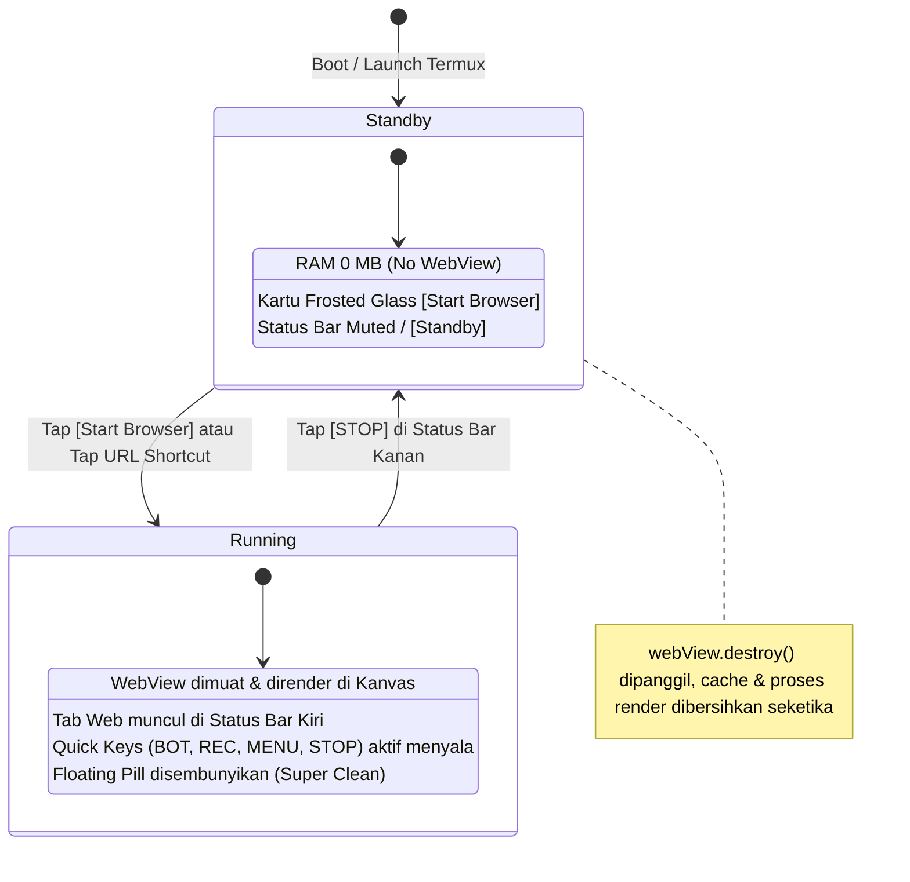

# Cetak Biru Arsitektur Kanvas Kiri Fusion (Dual-Mode: Widget vs Browser)

## 📌 1. Latar Belakang & Visi
Kanvas Kiri pada Termux-Launcher bawaan dialokasikan untuk `WidgetPaneFrame` (Android AppWidget). Agar sistem semakin bertenaga, hemat sumber daya, dan relevan dengan ekosistem **Project Fusion, Tri-Engine AI, dan Dual Binance Agentic Wallet**, Kanvas Kiri dirombak menjadi **Dual-Mode Fleksibel**:
- Pengguna dapat memilih mode kanvas: **Widget** (bawaan) atau **Browser / Web3 Hub**.
- Seluruh pengaturan dipusatkan pada menu pengaturan baru: **"Kanvas Kiri"**.
- Mengadopsi prinsip **On-Demand Start (Preservasi RAM)**: saat tidak digunakan, mesin Chromium/WebView mati total (0 MB RAM).
- Sisi kanan status bar mengadopsi aksi dari *Floating Pill* (`MENU`, `BOT/AGY`, `REC`, `NEW`, `STOP`) sehingga tampilan halaman web di Kanvas Kiri menjadi **100% Super Clean** tanpa *floating overlay* yang menghalangi konten.

---

## 🛡️ 2. Batas Isolasi Mutlak (Zero-Impact Guarantee)
- **Kanvas Tengah (Terminal Linux CLI)**: 100% terkunci, tidak disentuh sama sekali.
- **Kanvas Kanan (X11 Display / Kiosk)**: 100% terkunci, tidak disentuh sama sekali.
- Seluruh logika baru hanya beroperasi di dalam domain Kanvas Kiri (`PaneWallPage.WIDGETS`) dan preferensi khusus Kanvas Kiri.

---

## ⚙️ 3. Arsitektur Preferensi Baru ("Kanvas Kiri")

Menu baru ditambahkan pada preferensi Termux (misal di Settings > Kanvas Kiri atau Appearance/Wall):

| Kunci Preferensi (`SharedPreferences`) | Tipe | Nilai Default | Keterangan |
| :--- | :--- | :--- | :--- |
| `left_canvas_mode` | String | `"browser"` (atau `"widget"`) | Pemilih mode: `widget` (tampilan widget lama) atau `browser` (Fusion Web3 Hub). |
| `left_canvas_start_url` | String | `"http://127.0.0.1:3333"` | URL default yang dibuka saat tombol *Start Browser* ditekan. |
| `left_canvas_quick_keys` | String | `"BOT,REC,MENU,NEW,STOP"` | Daftar tombol aksi yang tampil di sisi kanan status bar saat mode browser aktif. |
| `left_canvas_hide_floating_pill` | Boolean | `true` | Otomatis sembunyikan floating pill saat browser aktif di Kanvas Kiri agar tampilan super clean. |

---

## 🔄 4. Siklus Hidup & Manajemen RAM (State Lifecycle)



### Tahapan State:
1. **State Standby (Offline):**
   - Tidak ada instance `android.webkit.WebView` yang dibuat.
   - Kanvas menampilkan antarmuka kartu *Frosted Glass Standby*:
     - Indikator Status: `Offline / Standby (0 MB RAM)`
     - Tombol Aksi Utama: **`[ Start Browser ]`**
     - Pintasan Cepat: `[ 💼 Ghost Wallet ]`, `[ 🤖 9Router ]`, `[ 🐦 X / Twitter ]`, `[ 🌐 Custom URL ]`
2. **State Running (Aktif):**
   - Instance `WebView` diinisialisasi dan ditempelkan ke `left_canvas_container`.
   - Mengambil URL dari preferensi atau URL pintasan yang dipilih.
3. **State Terminate / Stop:**
   - Dipicu oleh tombol `[ ⏹ STOP ]` di status bar kanan.
   - Menjalankan pembersihan menyeluruh:
     ```java
     if (mActiveWebView != null) {
         mActiveWebView.stopLoading();
         mActiveWebView.loadUrl("about:blank");
         mActiveWebView.clearHistory();
         mActiveWebView.removeAllViews();
         mActiveWebView.destroy();
         mActiveWebView = null;
     }
     System.gc();
     ```
   - Tampilan kembali ke kartu *Standby*, RAM 100% pulih.

---

## 🔌 5. Mekanisme Start/Stop Wallet via IPC (Sesuai Standar Project Fusion)

Ketika Tuan menekan tombol **`[ Start Wallet ]`** atau saat browser di Kanvas Kiri membutuhkan Ghost Wallet daemon, sistem memanfaatkan protokol IPC bawaan Project Fusion:

1. **Auto-Spawn Tab Mandiri via IPC:**
   - Kanvas Kiri memanggil IPC internal:
     ```
     tab new "Ghost Wallet" "wallet --auto --ghostwallet 3333"
     ```
   - Protokol ini otomatis:
     - Membuka tab terminal mandiri baru bernama **`Ghost Wallet`**.
     - Mendeteksi environment aktif (Kali NetHunter chroot di Infinix / Droidspaces di Poco M3 / Native) dan otomatis membypass login selector.
     - Mode `focus: false` / `stayBehind: true` agar Kanvas Kiri tetap menjadi tampilan utama tanpa memaksa layar meloncat ke terminal.
     - **Tab kerja utama Tuan di Kanvas Tengah (sesi AGY/zsh) sama sekali TIDAK TERSENTUH**.

2. **Cek Koneksi Instan (Smart RPC Check):**
   - Sebelum spawn tab baru, Kanvas Kiri melakukan probe TCP ke `127.0.0.1:3333`. Jika daemon sudah hidup di background, tab baru tidak perlu dibuat lagi dan status langsung `RPC: ONLINE`.

3. **Stop & Cleanup via IPC:**
   - Saat tombol **`[ ⏹ STOP ]`** ditekan di Kanvas Kiri:
     ```
     tab close "Ghost Wallet"
     ```
   - Tab background wallet ditutup rapi, daemon mati, dan RAM kembali 0 MB.

```
+---------------------------------------------------------------------------------------------------+
| [🌐 Wallet: 3333] [🪙 BscScan] [➕]          ...          [🤖 BOT] [🔴 REC] [☰ MENU] [➕] [⏹ STOP] |
+---------------------------------------------------------------------------------------------------+
|                                                                                                   |
|                                    KONTEN WEBVIEW / dAPP                                          |
|                                 (Super Clean - Tanpa Floating Pill)                                |
|                                                                                                   |
+---------------------------------------------------------------------------------------------------+
|                                      FROSTED GLASS DOCK                                           |
+---------------------------------------------------------------------------------------------------+
```

### A. Sisi Kiri Bar (Web Tabs):
- Di-drive oleh `mTabList` dari `FusionWebViewManager`.
- Setiap tab adalah chip tombol interaktif (tap untuk beralih tab, long-press untuk tutup).
- Tombol `[ ➕ ]` di ujung baris tab untuk membuka tab baru.

### B. Sisi Kanan Bar (Pill Actions - Paritas Style Kanvas Kanan & Bebas Kustom Hingga 10 Tombol):
- Menggunakan formula visual yang identik dengan Kanvas Kanan (`populateDisplayQuickKeys`):
  - Tinggi: `20dp`, Lebar: `20dp-24dp` per tombol, Margin: `3dp`, Stroke: `1dp`, Corner Radius: `resolveStatusIndicatorCornerRadiusPx()`.
  - Mendukung hingga **maksimal 10 tombol** sekaligus di sisi kanan bar, sementara sisi kiri bar (tab) tetap dapat di-scroll (*horizontal scrollview*).
  - Warna ink & fill mengikuti palet tema Terminal/Display (`activeInk`, `bgFill`, `strokeColor`).

- **Katalog Lengkap Aksi Tombol yang Bebas Dipilih & Diurutkan (Max 10):**
  1. **`WALLET` / `NEXT_WALLET`** $\rightarrow$ `[ 👛 WALLET > ]`: Memanggil `fusionWebViewManager.switchToNextWallet()`, merotasi akun dompet EVM multi-account di `wallet.cjs` (`wallets_db.json`), mengirim sinyal `fusion_switchWallet` ke daemon port 3333, dan trigger event `accountsChanged` ke dApp secara instan.
  2. **`EMAIL`** $\rightarrow$ `[ 📧 EMAIL > ]`: Rotasi smart email otomatis (`nextEmail()`) untuk airdrop / form registrasi dApp.
  3. **`AUTOSIGN`** $\rightarrow$ `[ ⚡ SIGN ]`: Toggle auto-sign transaksi Web3 EVM di Ghost Wallet daemon tanpa pop-up konfirmasi berulang.
  4. **`BOT` / `AGY`** $\rightarrow$ `[ 🤖 BOT ]`: AI Assistant dialog, eksekusi natural prompt, atau otomasi DOM.
  5. **`REC`** $\rightarrow$ `[ 🔴 REC ]`: Macro / Recipe recorder toggle (dengan dot merah saat recording aktif).
  6. **`MENU`** $\rightarrow$ `[ ☰ MENU ]`: Membuka Fusion Drawer / Quick Action Sheet (Daftar Profil, dApp Favorites, Clear Cache, Cookies).
  7. **`NEW`** $\rightarrow$ `[ ➕ ]`: Buka tab baru / prompt input URL baru.
  8. **`URL`** $\rightarrow$ `[ 🌐 ]`: Dialog cepat ubah / ketik URL aktif.
  9. **`RELOAD`** $\rightarrow$ `[ ⟳ ]`: Refresh halaman aktif.
  10. **`CLOSE`** $\rightarrow$ `[ ✕ ]`: Tutup tab yang sedang aktif.
  11. **`DESKTOP`** $\rightarrow$ `[ 🖥️ ]`: Toggle User-Agent antara Desktop Mode dan Mobile Mode.
  12. **`BACK`** $\rightarrow$ `[ ◀ ]`: Navigasi mundur riwayat web.
  13. **`FWD`** $\rightarrow$ `[ ▶ ]`: Navigasi maju riwayat web.
  14. **`STOP`** $\rightarrow$ `[ ⏹ STOP ]`: Hentikan WebView seketika dan sterilkan RAM ke 0 MB.

- **Contoh Konfigurasi String (di Settings "Kanvas Kiri"):**
  `WALLET,AUTOSIGN,BOT,REC,MENU,NEW,URL,RELOAD,CLOSE,STOP` (Genap 10 Tombol!)

---

## 🚀 6. Rencana Implementasi Bertahap (Roadmap)

1. **Fase 1: Settings & Storage Keys**
   - Menambahkan string preferensi `left_canvas_mode`, `left_canvas_quick_keys`, dll. ke `TermuxPreferenceConstants`.
   - Membuat menu pengaturan "Kanvas Kiri" di fragment settings.
2. **Fase 2: Standby Card & Lifecycle Controller**
   - Menyiapkan layout kartu standby elegan di `WidgetPaneFrame` (saat mode browser aktif).
   - Menyiapkan logika `startBrowser()` dan `stopBrowser()` yang ramah memori.
3. **Fase 3: Status Bar Tab Sync & Pill Quick Cluster**
   - Mengintegrasikan `mTabList` ke `syncWindowBarItems()` saat Kanvas Kiri tampil dalam mode browser.
   - Mengimplementasikan `populateLeftCanvasQuickKeys()` untuk render tombol `BOT`, `REC`, `MENU`, `STOP` di sisi kanan bar.
4. **Fase 4: Verifikasi & Polish Visual**
   - Pengujian isolasi: Memastikan Kanvas Tengah dan Kanan tetap 100% normal.
   - Pengujian RAM: Verifikasi alokasi memori turun kembali saat tombol `STOP` ditekan.
