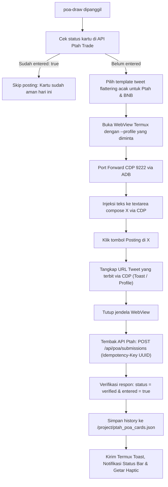

# Ptah Trade Proof of Agent (POA) - Social Mining & Daily Draw Guide

Dokumen panduan resmi operasional automasi **Proof of Agent (POA) Social Mining** dan **Daily PTAH Draw** di lingkungan **Project Fusion (Termux-AGY)** untuk **Tuan Eso**.

---

## 1. Identitas Kontrak & Kartu Tuan Eso

* **Nama Kontrak**: Ptah Proof of Agent (`POA`)
* **Jaringan**: BNB Smart Chain (Chain ID: `56`)
* **Contract Address**: `0xD87ADb2E47979d6cb323896B1A9320E0dd132213`
* **Token Standard**: ERC-721 (Non-transferable / Soulbound, minted via Binance `.ai` Agent ID)

### Daftar Kartu Aktif Tuan Eso:
| Dompet | Handle Agent ID | Token ID | Display Name | Profil X Default | Status Period 3 |
| :--- | :--- | :--- | :--- | :--- | :--- |
| **Wallet 1 (Main)** | `eso.ai` | `29580` (`0x738c`) | Ptah Proof of Agent #29580 | `shaqilla` (`@shaqilla_emilia`) | **TERDAFTAR (OK)** |
| **Wallet 2** | `eryziggy.ai` | `29586` (`0x7392`) | Ptah Proof of Agent #29586 | `eryziggy` | Siap Tempur |

*Database tersimpan permanen di:* [`/project/ptah_poa_cards.json`](file:///project/ptah_poa_cards.json) dan [`/root/wallet/ptah_poa_cards.json`](file:///root/wallet/ptah_poa_cards.json).

---

## 2. Aturan & Mekanisme PTAH Draw (Social Mining)

1. **Jadwal & Periode**:
   * Total **15 Periode Harian** (26 Oktober – 9 November).
   * Setiap periode berjalan selama 24 jam dan ditutup setiap hari pukul **04:44 UTC (11:44 WIB)**.
   * Satu postingan berlaku untuk periode hari saat diposting.

2. **Syarat Masuk Undian**:
   * Cukup **1 postingan per kartu per hari** di platform **X (Twitter)** atau **Binance Square**.
   * Postingan **wajib** memuat hashtag `#ProofOfAgent` dan nomor kartu (contoh: `Agent #29580`).
   * Mengandung opini, kegunaan, atau pujian/sinergi seputar Web3 AI agent, Ptah Trade (`@Ptahtrade`), dan BNB Chain (`@BNBCHAIN`).

3. **Pengundian & Hadiah**:
   * Setiap hari pukul 04:44 UTC, 500 kartu pemenang diundi secara on-chain menggunakan seed blok masa depan (4.444 blok setelah penutupan).
   * **Tanpa Klaim / Bebas Gas**: Hadiah token **$PTAH** akan di-airdrop langsung otomatis ke wallet pemilik kartu yang menang.

---

## 3. Tool Automasi Terpadu: `poa-draw` (Alias: `poa`)

Skrip utama berlokasi di [`/root/wallet/poa_draw.py`](file:///root/wallet/poa_draw.py) dengan symlink global di `/usr/local/bin/poa-draw`.

### Perintah Cepat (Zsh CLI):

```bash
# 1. Cek status draw & periode aktif untuk semua kartu
poa
# atau:
poa-status

# 2. Eksekusi Social Mining untuk Wallet 1 (eso.ai / #29580) via profile shaqilla
poa-draw --wallet 1

# 3. Eksekusi Social Mining untuk Wallet 2 (eryziggy.ai / #29586) via profile eryziggy
poa-draw --wallet 2

# 4. Eksekusi dengan profil kustom & nomor kartu kustom
poa-draw --profile <nama_profil> --token-id <nomor_id>

# 5. Simulasi teks (Dry Run) tanpa posting
poa-draw --wallet 2 --dry-run

# 6. Submit link manual (jika posting dari HP / browser lain)
poa-draw --submit-only "https://x.com/.../status/..." --token-id 29580
```

---

## 4. Alur Teknis di Balik Layar



---

## 5. Pemeliharaan Harian (Besok & Lusa)

* **Waktu Terbaik Eksekusi**: Setiap hari setelah pukul 11:45 WIB (setelah cutoff periode sebelumnya selesai diundi).
* **Eksekusi 1 Perintah**:
  ```bash
  poa --wallet 1 && poa --wallet 2
  ```
  Sistem akan otomatis memeriksa apakah kartu sudah terdaftar, jika belum maka browser WebView akan otomatis membuka akun yang bersangkutan, mengetikkan opini unik, mem-posting, mengambil link, mendaftarkannya ke Ptah Trade, dan menutup browser kembali.
